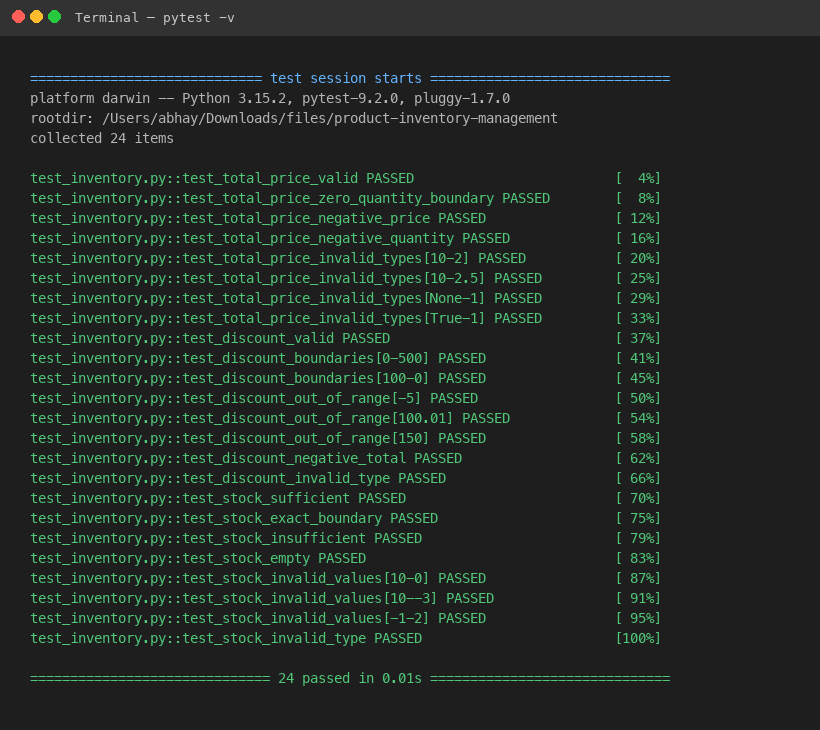
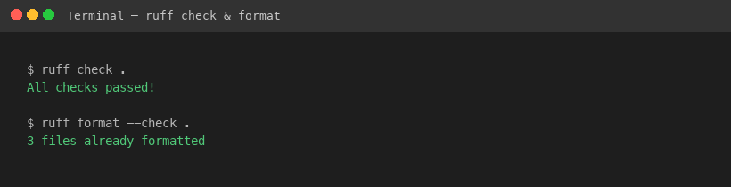

# Product Inventory Management

A Python application that manages product pricing, discounts and stock
availability, with input validation, exception handling, logging, pytest
unit tests and Ruff linting/formatting.

## Features Implemented

- `calculate_total_price(price, quantity)` – total cost with validation of price and quantity.
- `apply_discount(total, discount_percent)` – discounted amount; discount must be 0–100.
- `check_stock(available_stock, requested_quantity)` – returns `True` if the request can be fulfilled, `False` otherwise.
- Exception handling: `TypeError` for wrong types, `ValueError` for out-of-range values.
- Logging to `application.log` (product checks, successful operations, warnings, errors).
- 24 pytest tests (valid, boundary and invalid inputs).
- Ruff linting and formatting.

## Project Structure

```
product-inventory-management/
├── inventory.py
├── test_inventory.py
├── README.md
├── .gitignore
├── screenshots/
│   ├── pytest.png
│   └── ruff.png
└── application.log   (generated during execution)
```

## macOS Setup

1. Install Homebrew (if needed): https://brew.sh
2. Install Python 3:
   ```bash
   brew install python
   python3 --version
   ```
3. Clone the repository and create a virtual environment:
   ```bash
   git clone https://github.com/mca2026abhayg-svg/product-inventory-management.git
   cd product-inventory-management
   python3 -m venv .venv
   source .venv/bin/activate
   ```

## Installation

```bash
pip install pytest ruff
```

## Execution

```bash
python inventory.py
```

You will be prompted for product name, price, quantity, discount and stock.
Activity is logged to `application.log`.

## Testing

```bash
pytest -v
```

## Linting and Formatting (Ruff)

```bash
ruff check .          # lint
ruff check . --fix    # apply automatic fixes
ruff format .         # format code
```

## Screenshots

### Pytest Execution (24 passed)



### Ruff Checks (All passed)


